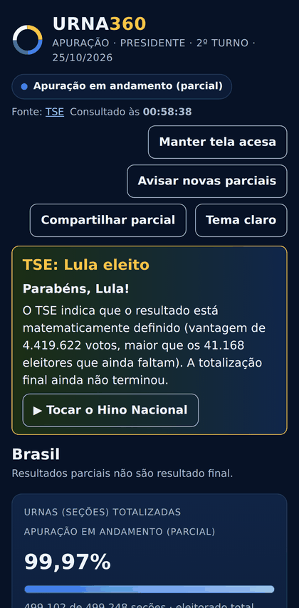
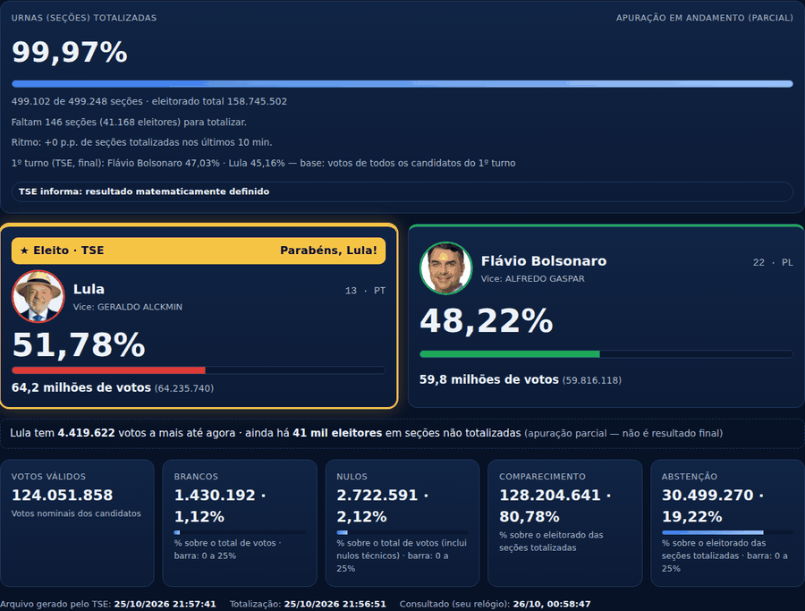
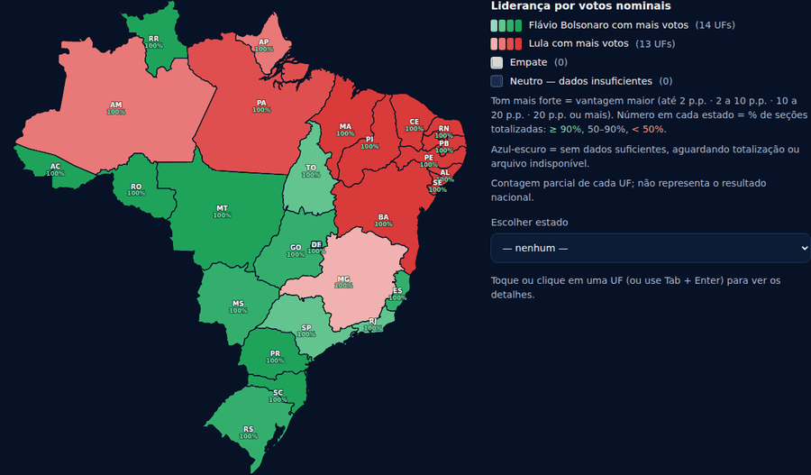
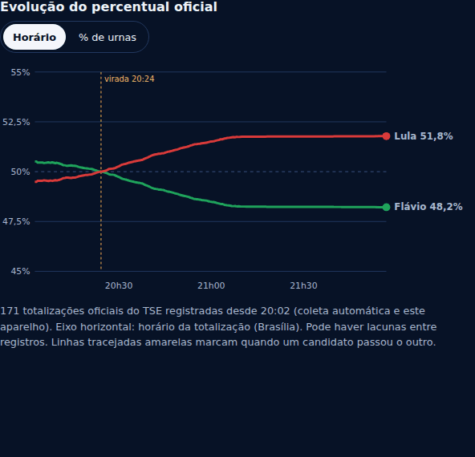
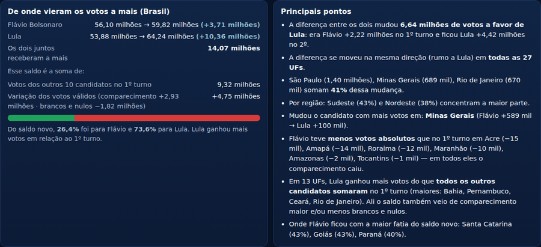
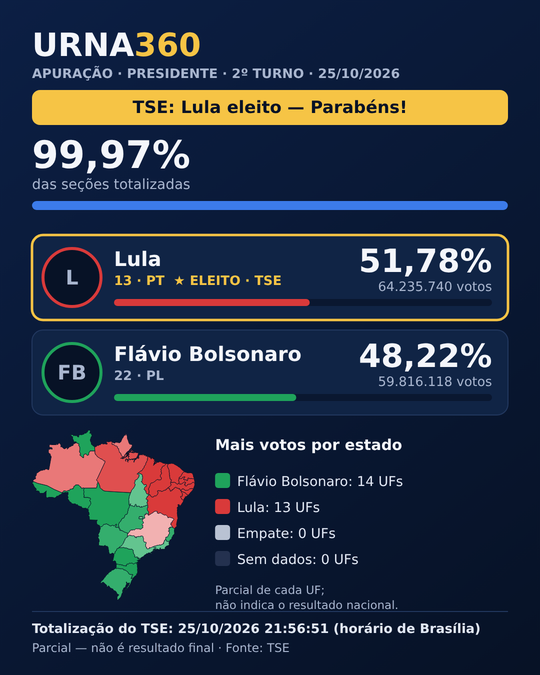
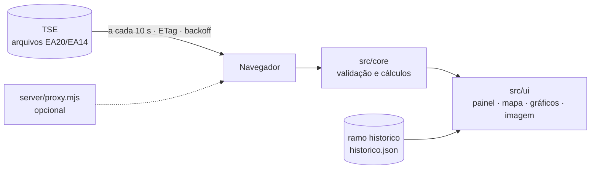

<div align="center">

# 🗳️ URNA360

**Painel da apuração do 2º turno presidencial de 25/10/2026, com dados oficiais do TSE.**

[](https://github.com/kelmanymarques-cmd/urna360/actions/workflows/ci.yml)
[](https://github.com/kelmanymarques-cmd/urna360/actions/workflows/publicar-site.yml)


### [▶ Abrir o painel](https://raw.githack.com/kelmanymarques-cmd/urna360/site/index.html)

<sub>Na primeira visita, o raw.githack mostra um aviso: toque em <b>“Open the page”</b>.</sub>



</div>

---

## Sumário

- [Sobre](#sobre)
- [Princípios](#princípios)
- [Funcionalidades](#funcionalidades)
- [Capturas](#capturas)
- [Fonte dos dados](#fonte-dos-dados)
- [Como funciona](#como-funciona)
- [Rodar localmente](#rodar-localmente)
- [Testes](#testes)
- [Publicação e automações](#publicação-e-automações)
- [Estrutura do projeto](#estrutura-do-projeto)
- [Limitações conhecidas](#limitações-conhecidas)
- [Créditos e licença](#créditos-e-licença)

## Sobre

O URNA360 acompanha a totalização do 2º turno entre **Flávio Bolsonaro (22)** e **Lula (13)** direto dos arquivos públicos do Tribunal Superior Eleitoral. Ele funciona no celular, no tablet e no computador, atualiza sozinho a cada 10 segundos e mostra o Brasil, as 27 UFs, as regiões e os municípios.

## Princípios

| | |
|---|---|
| **Só dado oficial** | Todo número vem de um arquivo do TSE. Nada é estimado, previsto ou preenchido. Quando o TSE publica votos zerados (`dv="n"`), o painel mostra “indisponível”, nunca 0%. |
| **Neutralidade** | Os dois candidatos recebem o mesmo tratamento visual e textual. Avisos de virada, selo de eleito, parabéns e Hino Nacional são idênticos para qualquer um. |
| **Transparência** | Simulações do TSE (`f="s"`) aparecem com a faixa “NÃO são resultados reais”. Cálculos derivados (ritmo, “conta da vitória”, análise) trazem rótulo e limites explícitos. |
| **Testado** | Testes unitários, E2E em 3 tamanhos de tela e verificações com arquivos reais do TSE nas Actions. O build falha se encontrar dado de teste no pacote final. |

## Funcionalidades

| Área | O que mostra |
|---|---|
| **Brasil** | Status oficial, % de seções, candidatos com foto e vice, votos em milhões, diferença, eleitores que faltam, ritmo e estimativa de término (rotulada), brancos, nulos e abstenção |
| **Conta da vitória** | Quantos votos garantem a eleição matematicamente, com base nos eleitores das seções ainda não totalizadas |
| **Mapa** | Cor da liderança com tons pela vantagem (verde = Flávio, vermelho = Lula, neutro sem dados); % apurado em cada UF; camadas neutras de totalização, brancos, nulos e abstenção; texturas para daltonismo; tela cheia |
| **UF** | Detalhes, comparação com o 1º turno e busca de município |
| **Regiões** | Soma dos votos oficiais das UFs de cada região |
| **Gráficos** | Progresso por UF e evolução da apuração (por horário ou % de urnas), com as viradas marcadas |
| **1º × 2º turno** | Cartões, base selecionável e tabela ordenável com mudança de liderança |
| **Análise 1º → 2º** | De onde vieram os votos a mais, divisão do saldo, mudança por região e UF e destaques gerados dos números |
| **Avisos** | Virada, nova parcial (vibração ou bip), eleito pelo TSE com selo, parabéns e Hino Nacional |
| **Compartilhar** | Imagem PNG 1080×1350 com a parcial |
| **Outros** | Tema claro/escuro, instalável na tela inicial, “manter tela acesa”, acessível por teclado |

## Capturas

<table>
<tr>
<td width="50%"><br><sub>Resumo nacional</sub></td>
<td width="50%"><br><sub>Mapa com liderança e camadas</sub></td>
</tr>
<tr>
<td><br><sub>Evolução da apuração</sub></td>
<td><br><sub>Comparação 1º × 2º turno</sub></td>
</tr>
<tr>
<td><br><sub>Análise do 1º para o 2º turno</sub></td>
<td><br><sub>Imagem para compartilhar</sub></td>
</tr>
</table>

## Fonte dos dados

Base: `https://resultados.tse.jus.br/oficial` · documentação: [Informações técnicas sobre a divulgação de resultados 2026](https://www.tse.jus.br/eleicoes/informacoes-tecnicas-sobre-a-divulgacao-de-resultados) (especificações EA20, EA14 e EA12).

| Arquivo | Caminho |
|---|---|
| Resultado por UF / Brasil (EA20) | `/ele2026/6258/dados/<uf>/<uf>-c0001-e006258-u.json` |
| Acompanhamento (EA14) | `/ele2026/6258/dados/br/br-e006258-ab.json` |
| 1º turno (eleição 6257) | `/ele2026/6257/dados/<uf>/<uf>-c0001-e006257-u.json` |
| Municípios (config EA12) | `/ele2026/6258/config/mun-e006258-cm.json` |
| Resultado municipal | `/ele2026/6258/dados/<uf>/<uf><cd>-c0001-e006258-u.json` |
| Fotos | `/ele2026/6258/fotos/br/<sqcand>.jpeg` |

**Regras da especificação aplicadas**

- `dv="n"` → votos zerados pelo TSE, tratados como indisponíveis.
- `and`: `n` não iniciada, `p` em andamento, `f` finalizada. “Totalizada” só com `tf="s"`.
- % dos candidatos sobre os votos computados para candidatos (`vvc`); brancos e nulos sobre o total de votos (`tv`); abstenção sobre o eleitorado das seções totalizadas.
- Datas `dd/mm/aaaa hh:mm:ss`. A especificação não declara fuso; o painel mostra o texto como publicado e usa Brasília (UTC−3) só para ordenar.
- `md="e"` (matematicamente definido): em 25/10/2026 o TSE publicou `md="e"` com `cand.e="n"` para os dois. Nesse caso o painel só nomeia o eleito se a vantagem oficial for maior que o eleitorado das seções não totalizadas (`esnt`).

**Comportamento observado:** `cache-control: max-age=42`, ETag e CORS que reflete a origem, então o navegador lê o TSE direto, sem servidor. Limite de 100 req/s por IP; o painel faz bem menos que isso.

## Como funciona



- **Validação:** cada arquivo é conferido (eleição 6258, turno 2, cargo 0001) antes de ser exibido. Um arquivo mais antigo que o já exibido é ignorado.
- **Resiliência:** timeout, backoff em erro e aviso de dado desatualizado; o último dado válido continua na tela.
- **Histórico:** a Action `historico` grava cada totalização nacional no ramo `historico`, que alimenta o gráfico de evolução para quem abriu o painel depois.

## Rodar localmente

Requer Node 20+.

```bash
npm ci
npm run dev        # proxy :8787 + Vite :5173
npm run build      # typecheck + build + checagem anti-fixture do dist/
npm start          # produção com Node: serve dist/ e /api em :8080
```

| Variável | Padrão | Uso |
|---|---|---|
| `VITE_TSE_BASE` | `/api/tse` | Base dos arquivos (use `https://resultados.tse.jus.br/oficial` para ler direto) |
| `VITE_INTERVALO_SEGUNDOS` | `10` | Intervalo de consulta (mínimo 10) |

## Testes

```bash
npm test           # unitários (Vitest)
npm run test:e2e   # Playwright sobre o build de produção
```

- **Unitários:** 73 passando, mais 4 que só rodam com arquivos reais do TSE (nas Actions).
- **E2E:** 20 cenários em desktop, celular e tablet. Herméticos: bloqueiam TSE, GitHub e jsDelivr e usam fixtures. Cobrem mapa, seleção e Esc, camadas, avisos, eleito, virada, compartilhamento, comparação, análise, ausência de rolagem lateral no celular e uso da largura em telas de 1920 px.
- **Dados reais:** `verificar-tse`, `analise-real` e `verificar-site` baixam os arquivos oficiais e conferem normalização, CORS, fotos e o site publicado.

## Publicação e automações

O link público serve o ramo `site` pelo raw.githack. O `index.html` desse ramo é um **carregador**: busca o commit mais recente pela API do GitHub e carrega o app pelo jsDelivr, que tem endereço imutável. Assim, cada publicação aparece sem cache velho.

| Workflow | Quando | Para quê |
|---|---|---|
| `ci` | push e PR | Typecheck, unitários, build e E2E; salva relatório no ramo `verificacao` se falhar |
| `publicar-site` | push na `main` que muda o app; manual | Testa, faz o build e atualiza o ramo `site` |
| `verificar-tse` | push em `src/core`; manual | Arquivos reais, normalizador, CORS e fotos |
| `verificar-site` | manual | Abre o site publicado num Chromium de celular e salva capturas |
| `historico` | manual | Grava a evolução oficial (até ~6 h) |
| `analise-real` | manual | Análise 1º → 2º turno com os 56 arquivos oficiais |
| `capturas-readme` | manual | Gera as imagens deste README |
| `campos-tse`, `sondar-tse`, `buscar-hino`, `conferir-publicacao`, `capturar-referencia` | manual | Conferências pontuais |
| `monitor` | desativado | Testes periódicos (desligado a pedido) |
| `pages` | manual | Alternativa via GitHub Pages, depois de ativá-lo em Settings → Pages |

| Ramo | Conteúdo |
|---|---|
| `main` | Código-fonte |
| `site` | Saída de build publicada. **Nunca abra PR nem faça merge dele na `main`.** |
| `historico` | `historico.json` com a evolução oficial |
| `verificacao` | Evidências das Actions: arquivos reais, cabeçalhos e capturas |

## Estrutura do projeto

```
src/
  config.ts          eleição, candidatos, UFs, regiões, caminhos do TSE
  core/              parse, normalize (EA20/EA14), calc, analise, types
  data/              fetcher e store (consulta, backoff, ETag)
  ui/                mapa, camadas, comparação, análise, imagem, extras, format
  main.ts            montagem da página
  styles.css         temas claro e escuro
public/              ícones, manifesto e hino (domínio público)
server/proxy.mjs     proxy opcional com lista branca, cache e CSP
scripts/             carregador do site, publicação, capturas, checagens
tests/               unit/, e2e/ e fixtures/
.github/workflows/   CI, publicação e verificações
docs/img/            capturas do README
```

## Limitações conhecidas

- As assinaturas JWS dos arquivos do TSE não são verificadas.
- Fotos não aparecem na imagem compartilhada: o TSE não libera o uso em canvas, então aparecem as iniciais.
- A análise 1º → 2º turno usa saldos agregados. Ela mostra onde e quanto cada um cresceu, mas **não diz quem votou em quem**.
- Comparação com 2022, 2018 e 2014 ainda não implementada.
- O link pelo GitHub Pages (mais limpo) depende de ativação manual nas configurações do repositório.

## Créditos e licença

- Dados: [Tribunal Superior Eleitoral](https://resultados.tse.jus.br).
- Mapa: [@svg-maps/brazil](https://github.com/VictorCazanave/svg-maps), CC BY 4.0.
- Hino Nacional Brasileiro: gravação de domínio público (Coral do Exército), via Wikimedia Commons.
- Código sob licença MIT © 2026 Kelmany Marques.

Projeto independente, sem vínculo com o TSE, partidos ou candidatos.
